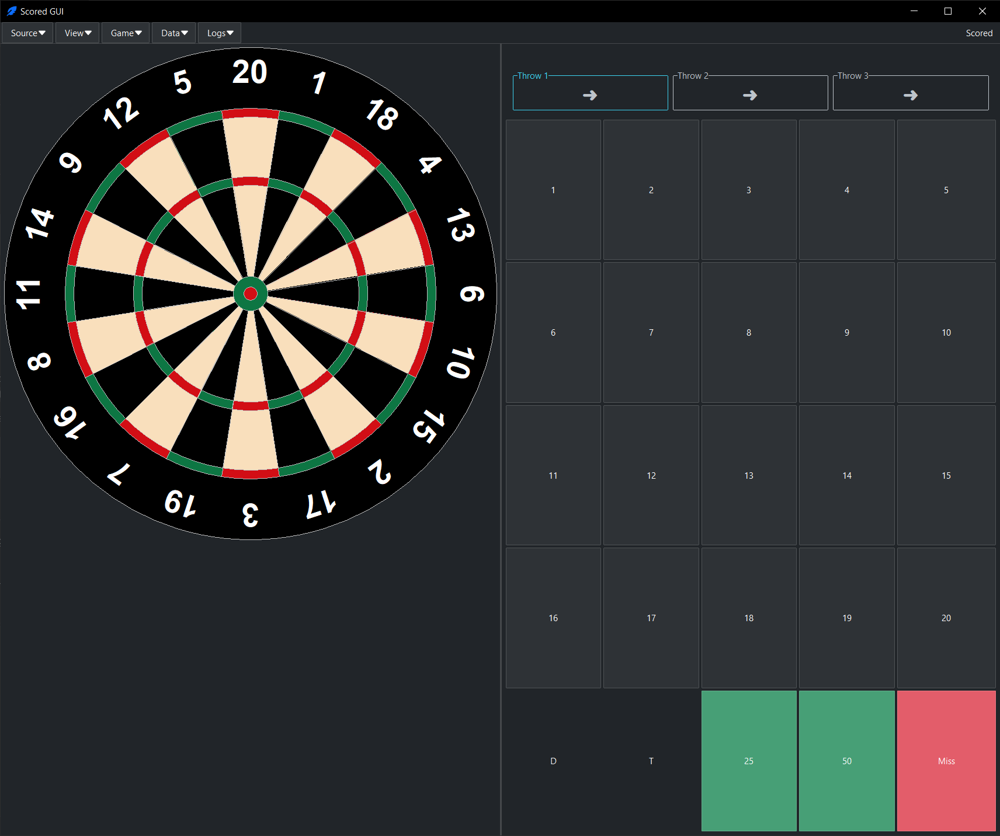

# Scored GUI

A simple tkinter based GUI for the scored project. The GUI is located in the `gui` folder.  

## Usage

To start the GUI, run the following command:

```bash
uv run scored-gui
```

Data collection is **disabled** by default, so no frames or labels are saved.
Enable it before playing a game from the **Data** menu in the menu bar
(*Select Data Directory…*), or start the GUI with data collection enabled from
the start:

```bash 
uv run scored-gui --data_dir <path_to_save_data>
```


## Sources
The GUI accepts different sources for the images. The following sources are currently supported:
- `camera` - uses the default camera of the system to capture images
- `video` - uses a video file as source, the path to the video file must be provided. This is useful for testing the GUI with pre-recorded videos.
- `http` - uses a http stream as source, the url to the stream must be provided. Use this if you want to use a secondary camera (for example an old phone) to make the images will running the application on a different device. The phone must be running an app that provides a http stream, for example the [IP Webcam](https://play.google.com/store/apps/details?id=com.pas.webcam&hl=de&gl=US) app for Android or the [Android IP Webcam](https://f-droid.org/de/packages/com.github.digitallyrefined.androidipcamera/) from F-Droid which is open source and does not have any ads. The url to the stream is usually in the format `http://<ip>:<port>/video`. 

A source can be set in the GUI by clicking on the "Source" button and selecting the desired source. Or during the start of the GUI by using the `--source` argument. For example to use a video file as source, run the following command:

```bash
uv run scored-gui --source <path_to_video_file>
```

## Playing Dart Legs
The app follows the basic rules of darts. To start a game first at the desired players. After words start a game and select desired options for that leg. currently legs must be played one by one there is now best of x legs option. The app will keep track of the scores and display the current score of each player. The app will also display the current player and the current throw. After a leg is finished, the app will display the winner and the scores of each player.

The `dartboard` view can be used to see the dart drawn in a canvas to visualize the throw. A dart can be dragged to a different position on the dartboard, the scores will reflect the new position of the dart. This can be used to correct the position of the dart if the model did not detect it correctly, or for labeling purposes. One can also click at the position where the dart landed to add the dart to the dartboard.

The 'camera feed` view shows the current image from the source, use it for debugging and to see if the images are captured correctly. 

All three views can be rearranged from the "View" menu. Every view has its own entry with a submenu of four options:

- **Left** shows the view in the left column.
- **Right** shows the view in the right column.
- **Floating** gives the view a window of its own, which stays on top of the main window. Closing that window hides the view.
- **Hidden** takes the view off screen.

The window is split into a left and a right column with a draggable divider that cannot be squeezed below what the panels need. A column with no views disappears and the other one takes the whole width. Views in the same column share the height equally.

The layout is remembered between sessions and stored in `layout.json` in the OS user state directory.

## Data Collection

The gui can be used to collect data for training the model. To do this, start a game and select the "Data Collection" option. The app will then save the images and the corresponding scores to a folder. 

Data collection is only active while a data directory is set. Without one, no
frames or labels are collected at all and the `annotation` view shows the
banner *Data collection is off — labels are not saved.* The **Data** menu in
the menu bar shows the current state (`Data Collection: Off` or the chosen
directory) and offers two actions:

- **Select Data Directory…** picks a folder and enables data collection.
- **Remove Data Directory** disables data collection again; previously saved
  data stays on disk, anything still held in memory for the current round is
  discarded.

The same state can be set at startup with `--data_dir <path>`, which stores
the data in that folder and enables collection right away. A round that was
partially in progress when collection was enabled is skipped, collection
starts with the next complete round.

The folder can be specified in the settings. Each Game will create a folder in there each player leg will create a subfolder. Each throw will create a subfolder with the image and a json file containing the scores. Folders are named based on the round and throw number of this throw. For example, the folder structure for a game with two players and two legs will look like this:

```
game_<time>
├── player1
│   ├── 1_1
│   │   ├── annotation.json
│   │   ├── image.jpg
│   ├── 1_2
│   │   ├── annotation.json
│   │   ├── image.jpg
│   ├── 1_3
│   │   ├── annotation.json
│   │   ├── image.jpg
├── player2
│   ├── 1_1
│   │   ├── annotation.json
│   │   ├── image.jpg

```

The image will be saved when the score is entered. So to get the correct image, make sure to enter the score after the dart has landed and before the next throw. The annotation can be changed after the player made its 3 throws, but by default the image will not be overwritten as the image of the first through should only contain one dart and so on. If one changes the first throw after the second throw and the image would be overwritten, the image would contain two darts although only one dart annotation is saved (This behavior can be toggled to also update the image if needed). Annotation with multiple throws on the image will contain multiple annotation data.

If a throw gets removed by default the annotation and image will be marked as deleted with a `_d` prefix but not deleted from the disk. This can be changed in the settings to delete the files instead of marking them as deleted.

## Annotation Panel

The `annotation` view shows the camera frame of the currently selected throw
with the darts that are visible on the board. It is used to label the tip and
the flight of every dart for training the model. A banner above the canvas
shows whether data collection is on: when it is off, labels are not saved (see
[Data Collection](#data-collection)).

- Click on the frame to place the **tip** of a dart, click again for its
  **flight**. The finished label is attached to the first dart that has no
  label yet; clicks keep adding labels until every dart is labeled. A draft
  (only the tip placed) can be cancelled with the Delete key.
- Click a drawn point or its table row to select it; drag it to move it. The
  table lists every dart with a color circle (matching its markers on the
  canvas), its score, tip, flight and where the label came from (`manual` or
  `copied`). The header above the canvas shows the round,
  throw, timestamp and how many of the darts are labeled (`y/x darts
  labeled`).
- `V` copies the labeled darts of the previous throw onto the current one.
  The automatic data collection already carries the previous throw's labels
  forward when a new frame arrives, so `V` only fills in what is missing.
  Copied labels are marked with `copied: true` in the annotation data.
- `1`, `2` and `3` switch between the throw tabs, `A`, `S` and `D` select the
  first, second or third dart, and the Delete key clears the label of the
  selected dart (the dart and its score stay in the list) or cancels an
  unfinished draft.
- The throw tabs at the top switch between the frames collected for the
  throws of the round.
- The mouse wheel zooms the frame in and out around the pointer — useful for
  placing or dragging a tip/flight onto the exact pixel. Once zoomed in, drag
  with the middle mouse button to pan, and the magnification is shown in the
  corner of the canvas.

The labels are written to disk as part of the round: when the turn is
confirmed, when the game ends, and when the app is closed. The `throws` entry
of each `annotation.json` holds one object per dart, in this shape:

```json
{
  "round": 1,
  "throw": 2,
  "time": 1730000000.0,
  "is_bust": false,
  "throws": [
    {"throw_data": {...}, "keypoints": {"tip": [0.1, 0.2], "flight": [0.3, 0.4], "copied": true}},
    {"throw_data": {...}, "keypoints": null}
  ]
}
```

`throw_data` is `null` for darts that were drawn on top of the frame without a
known score, and `keypoints` is `null` as long as the dart has not been
labeled. `tip` and `flight` are relative image coordinates (0.0-1.0).